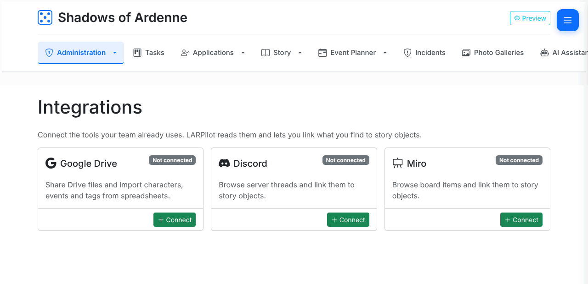
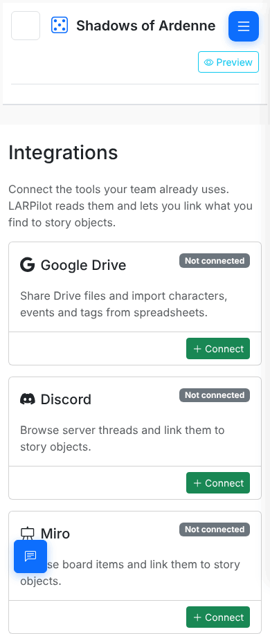
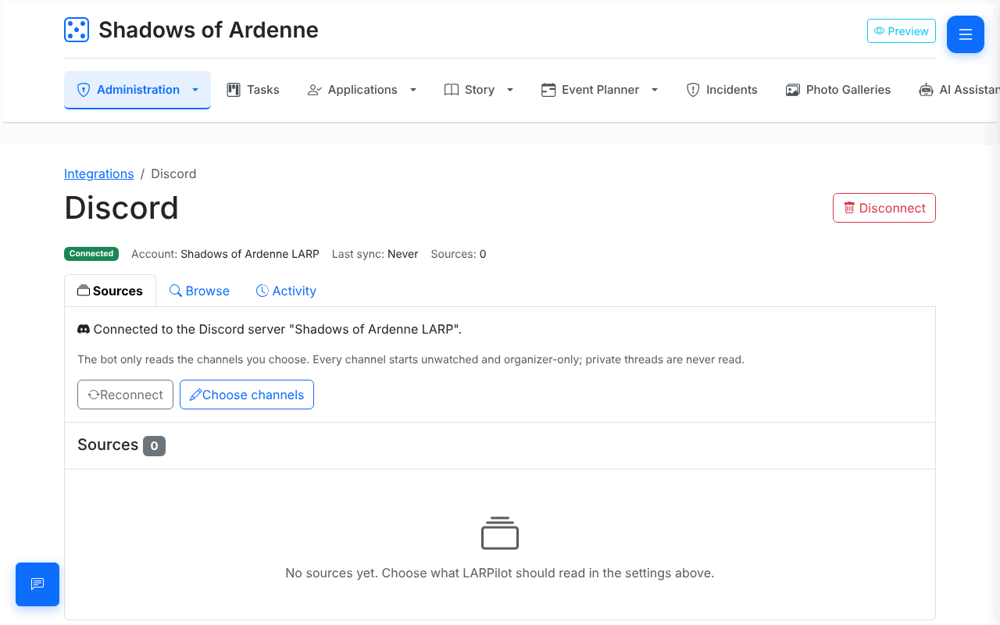
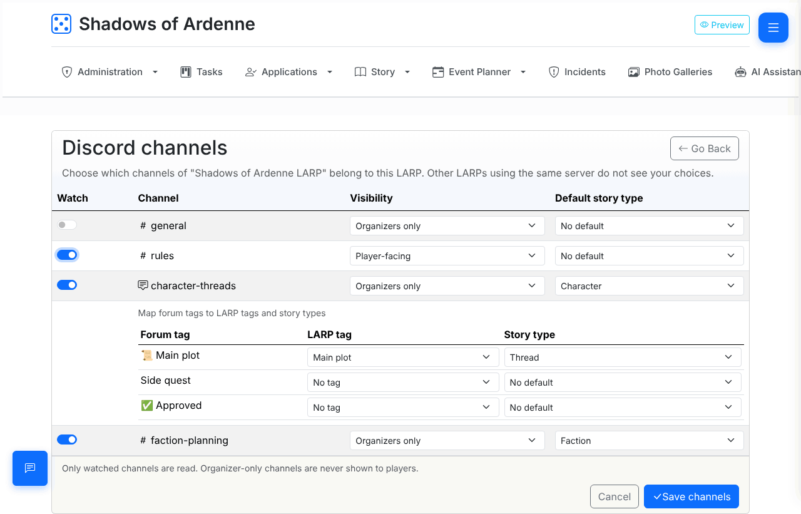
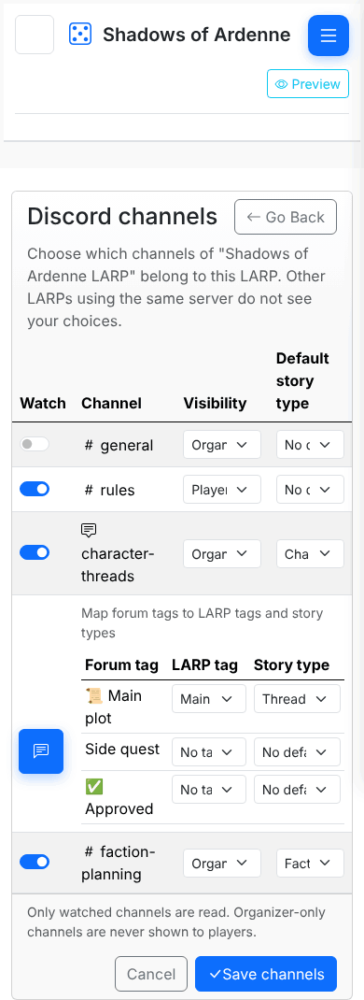
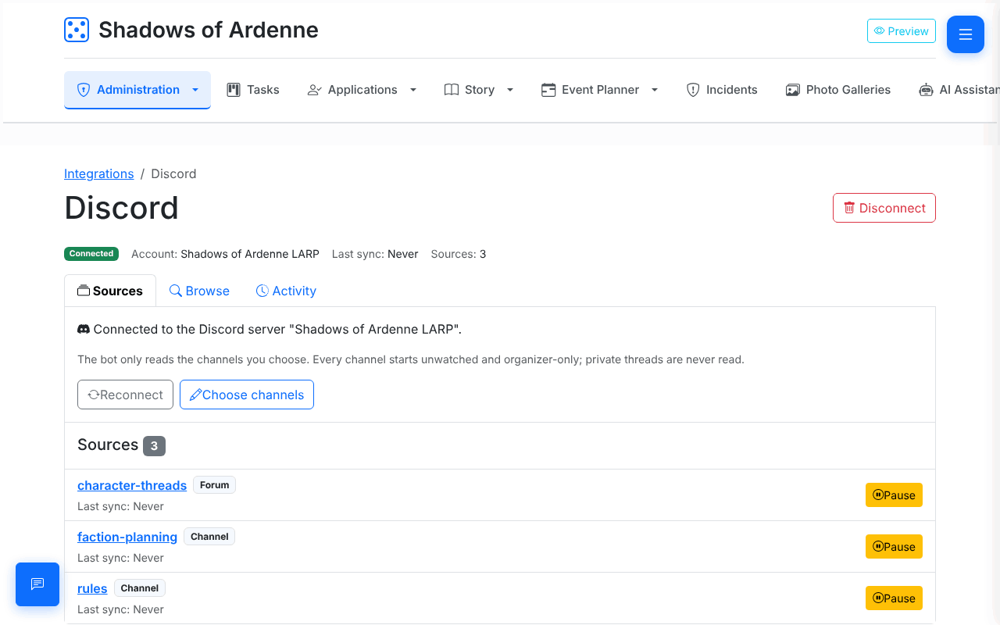
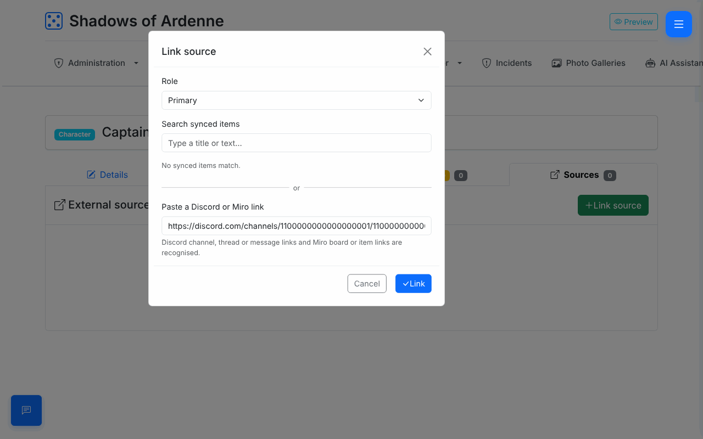
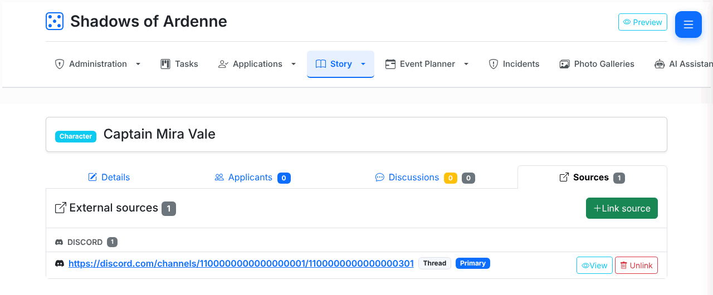

# Connect your Discord server

Most story decisions happen in Discord. When your server is connected, LARPilot
can show those conversations next to the characters, factions and threads they
are about, so the whole writing team can find them again.

This guide is for **LARP organizers**. It takes about five minutes.

> **Before you start**
>
> - You need to be an **organizer** of the LARP in LARPilot. Story writers can
>   link sources later, but only organizers can connect or disconnect Discord.
> - You need the **Manage Server** permission on the Discord server, because you
>   are adding a bot to it. If you are not a server admin, ask one to do the
>   invite step with you.
> - One LARP connects to **one** Discord server. The same server can be
>   connected to several LARPs; each LARP chooses its own channels.

## 1. Open the Integrations page

In your LARP, open **Administration → Integrations**. You can also use the
**Open integrations** link on the LARP dashboard.

On a phone

## 2. Invite the LARPilot bot

1. On the **Discord** card, click **Connect**.
2. Discord opens and asks where to add the **LARPilot** bot. Pick your server.
3. Discord lists what the bot is allowed to do. It only asks for two things:
   - **View Channels** – to see the channel list;
   - **Read Message History** – to read the conversations in channels you pick.

   The bot cannot post, react, delete messages or change anything on your server.
4. Click **Authorize**. Discord sends you back to LARPilot.

The Discord page now says **Connected to the Discord server "…"**.

If Discord shows an error, or you end up back in LARPilot without a server, try
again and make sure you picked a server where you have **Manage Server**.

## 3. Choose channels

Right after connecting, **no channel is read**. You decide which channels
belong to this LARP.

1. On the Discord page, click **Choose channels**.
2. Switch **Watch** on for every channel that holds story work for this LARP.
   Only text channels and forum channels are listed – voice channels and
   categories are skipped.
3. For each watched channel, set the **Visibility** (see below).
4. Optionally pick a **Default story type** – for example *Character* for a
   `#character-threads` forum. LARPilot uses it as a hint when it suggests what
   a thread is about.
5. Forum channels also list their **forum tags**. You can match each tag to a
   LARP tag and a story type, so a post tagged "Main plot" in Discord lines up
   with your "Main plot" tag in LARPilot.
6. Click **Save channels**. LARPilot confirms with *"Discord channels saved."*
   Click **Go Back** to return to the Discord page.

On a phone

The watched channels now appear under **Sources** on the Discord page. Use
**Pause** to stop reading a channel for a while without losing your settings,
and **Resume** to start again.

Other LARPs connected to the same server never see your channel choices, and
you never see theirs.

### Organizers only or player-facing?

Every channel starts as **Organizers only**. Pick the visibility that matches
who can read the channel *in Discord*:

| Visibility | Use it for | What LARPilot keeps |
| --- | --- | --- |
| **Organizers only** | Staff and writer channels players cannot see. | Titles, links, dates, authors and a **short excerpt** of the conversation. |
| **Player-facing** | Channels players can read, such as announcements or public forums. | Titles, links, dates and authors only – **no excerpts**. |

Excerpts are only kept for organizer-only channels, so nothing written in a
player channel is copied into LARPilot, and organizer-only material is never
shown to players.

## 4. What happens next

- LARPilot reads your watched channels in the background, **about every 30
  minutes**. New threads and posts appear on the **Browse** tab and in the
  **Discord inbox** after that, not instantly – see [Why is there a delay?](integrations-faq.md#why-does-it-take-a-few-minutes-for-new-discord-threads-to-show-up).
- **Sync now** on a source asks for an earlier check.
- The **Activity** tab shows when each channel was last read and whether
  anything went wrong.
- Private threads are never read. For **Organizers only** channels LARPilot
  keeps a short excerpt of the first and latest messages; for **Player-facing**
  channels it keeps only titles and links.

## 5. Link a conversation to a story object

Every character, faction, thread, quest and other story page has a
**Sources** tab.

1. Open the story object and go to **Sources**.
2. Click **Link source**.
3. Either search for a synced thread by its title, or paste a Discord link –
   a channel, thread or message link (right-click in Discord → **Copy Link**).
4. Choose a **Role**: *Primary* (where this was decided), *Mention* (it comes up
   here) or *Notes*.
5. Click **Link**.

The link appears under **Discord** on the Sources tab. Until the thread has
been synced, LARPilot shows its address; once synced, it shows the thread
title instead. **View** opens it in Discord.

Unlinking only removes the link in LARPilot. Nothing changes in Discord.

## 6. Triage new threads in the inbox

New threads and forum posts from watched channels land in the **Discord
inbox**, so you don't have to hunt for them. Open it from the **Inbox** tab
on the Discord page of the Integrations hub (the red number is how many are
waiting), from the Discord card on the hub, or – for story writers – from
**Story → Discord inbox**.

Each entry shows the title, the forum tags, the last activity and, for
organizer-only channels, a short excerpt. LARPilot also suggests what it
belongs to:

- **By name** – a story object whose title appears in the thread title, ignoring
  case, punctuation and accents. "Wolves – betrayal" suggests the faction
  *Wolves*.
- **By forum tag** – the story type and LARP tag you mapped to the post's forum
  tag in step 3.

For every entry you can:

- click a suggestion to link the thread to that story object at once;
- **Link…** to pick any story object by its title;
- **Create from thread** to make a new story object of the mapped type – the
  thread title becomes its title, the excerpt its description, mapped LARP
  tags are added, and the thread is linked to it;
- **Ignore** to hide it. Ignored threads stay ignored after later syncs; pick
  the *Ignored* status filter and **Restore** to bring one back.

Tick several entries to **Link selected…** or **Ignore selected** in one go.
Filter by channel, status (*Unreviewed* by default) and whether an entry has
suggestions. Organizers and story writers can use the inbox.

## Privacy, in short

- The bot reads **only** the channels you switched on. Everything else on the
  server is ignored.
- **Private threads are never read**, even inside a watched channel.
- LARPilot is an index, not a copy of your chat: it keeps titles, links and
  short excerpts (organizer-only channels only), never full conversations.
- Disconnecting deletes everything LARPilot stored from Discord for this LARP.

More in the [Q&A](integrations-faq.md).

## Change the server or disconnect

- **Reconnect** on the Discord page runs the invite again. Use it if someone
  kicked the bot, or to switch this LARP to a different server. Switching
  servers clears the channels and synced data of the old server.
- **Disconnect** removes Discord from this LARP. LARPilot asks you to confirm
  first. See [What happens when I disconnect?](integrations-faq.md#what-happens-when-i-disconnect-discord)

If the Discord page shows *"LARPilot cannot reach this Discord server any
more"*, the bot was removed from the server or lost its permissions. Click
**Reconnect** and invite it again.

## For the server admin

Hosting LARPilot yourself? The Discord application, bot token and redirect URL
are set up once per installation, not per LARP. See
[Deployment → Discord bot](../DEPLOYMENT.md#discord-bot) for the developer
portal steps and the `DISCORD_BOT_TOKEN`, `DISCORD_CLIENT_ID` and
`DISCORD_CLIENT_SECRET` secrets. Background reading also needs a running
`messenger:consume` worker – see
[Deployment → Background worker](../DEPLOYMENT.md#background-worker-messenger).
