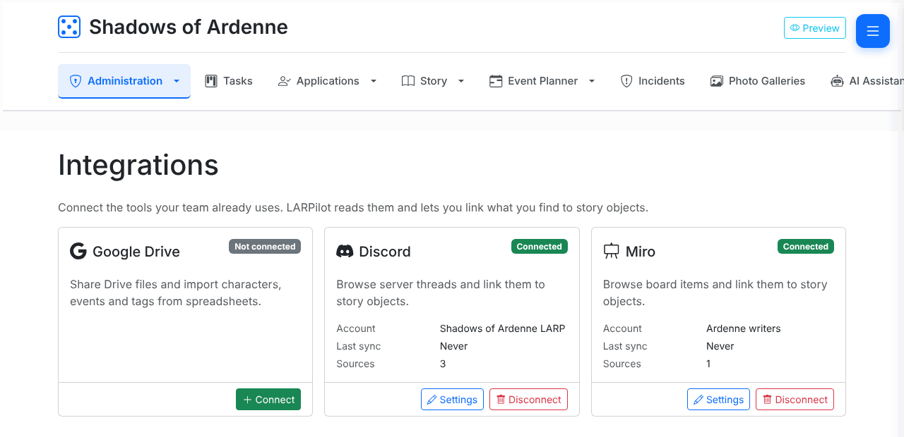
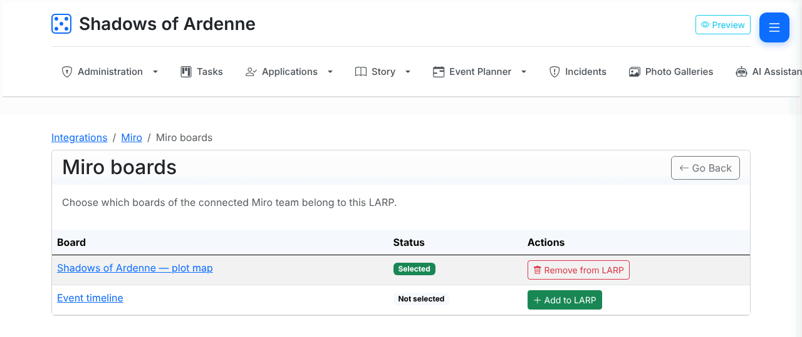
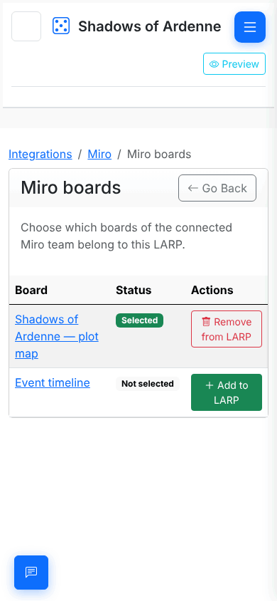
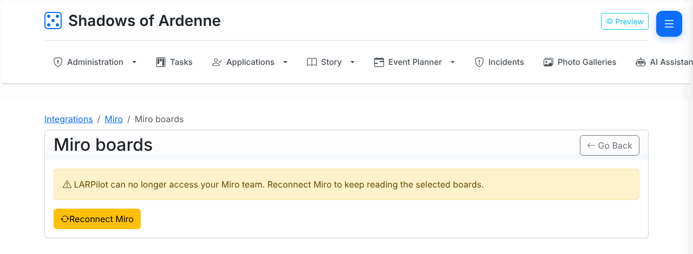

# Connect Miro

If your team maps the story on Miro boards – who knows whom, which faction
lives where, how a plot unfolds – you can connect those boards to your LARP.
You can link board items to story objects and import a story map into
LARPilot.

This guide is for **LARP organizers**. It takes a couple of minutes.

> **Before you start**
>
> - You need to be an **organizer** of the LARP in LARPilot. Story writers can
>   link sources later, but only organizers can connect or disconnect Miro.
> - You need a Miro account that is a member of the team that owns the boards.
> - One LARP connects to **one** Miro team. Each LARP picks its own boards.

## 1. Sign in with Miro

1. In your LARP, open **Administration → Integrations**.
2. On the **Miro** card, click **Connect**.
3. Miro opens. Sign in if asked, choose the **team** that owns your story
   boards, and allow access. LARPilot only asks to **read boards**; it cannot
   create, change or delete anything in Miro.
4. Miro sends you back to LARPilot. The Miro card now shows **Connected**.

## 2. Pick boards

Connecting does not read any board yet. You choose which boards belong to this
LARP.

1. On the Miro card, click **Settings**, then **Manage boards**.
2. Every board of the connected team is listed. Click **Add to LARP** on each
   board you want. Its status changes to **Selected**.
3. Click **Remove from LARP** to drop a board again.

On a phone

Selected boards appear under **Sources** on the Miro page. Click a board name
to open it in Miro.

## 3. What happens next

Click **Browse board** next to a board to see its frames, items and
connectors, link them to story objects, and [import a story map](#5-import-a-story-map).

Miro does not tell LARPilot when a board changes, so boards are read when you
open them in LARPilot and kept for a short while, rather than synced in the
background.

## 4. Keep the connection alive

Miro gives LARPilot access for one hour at a time, and LARPilot renews it on
its own. You do not need to do anything as long as the connection keeps
working.

If Miro stops accepting the renewal – for example because someone removed
LARPilot under *Profile settings → Your apps* in Miro, or left the team –
LARPilot shows a yellow banner:

> *LARPilot can no longer access your Miro team. Reconnect Miro to keep reading
> the selected boards.*

Click **Reconnect Miro** (or **Reconnect** on the Integrations page) and sign
in again. Your board choices are kept.

## 5. Import a story map

You can turn a Miro story map into LARPilot story objects and relations
without retyping it. Organizers and story writers can run the import.

1. Open the board (**Browse board** on the Miro page) and click **Import…**.
2. LARPilot reads the board and shows a preview. **Nothing is written yet.**
   Each suggested change is a row with a checkbox:
   - **Link** – the Miro element is linked to an existing story object. The
     *Now in LARPilot* column shows the object as it is today, *After import*
     shows it linked to the element. Rows marked *Exact title match, no type
     tag* are less certain; check them before ticking.
   - **Create** – a new story object of the tagged type is created with the
     element's title and linked to it.
   - **Create relation** – a relation is created between the two story
     objects at the ends of a connector.
3. Tick the rows you want and click **Import selected**. Only ticked rows are
   imported, all in one go. A relation whose new story object you did not
   tick is skipped.
4. Run the import again whenever the board changes: it only shows what is not
   in LARPilot yet. Elements already linked are counted, not listed again.

Descriptions are not copied from Miro, and the import never changes or deletes
existing story objects.

Below the preview, LARPilot lists elements that need your decision (unmapped
elements, connectors without a known relation type, relations that cannot
connect those kinds of story objects) and characters that could be members of
a faction. Faction membership is shown for information only – add members on
the faction page.

### Tag your boards for good suggestions

- **Tag cards, sticky notes and app cards with their type.** Use Miro tags
  named `Character`, `Faction`, `Thread`, `Quest`, `Place`, `Item` or `Event`
  (upper or lower case). A tagged element is matched to an existing story
  object of that type with the same name – ignoring case, accents and
  punctuation, so "Captain Mira Vale" matches "Captain Mira Valé" – or offered
  as a new one. Use one type tag per element.
- **Use the same names as in LARPilot.** Untagged elements (including shapes
  and text) are only matched when the title is exactly the same; others are
  listed as *unmapped* for you to link by hand in the board browser.
- **Name frames after factions, threads or places.** A frame called
  "House Ardenne" is matched to the faction, thread or place of that name, and
  characters tagged `Character` inside a faction frame are shown as possible
  members.
- **Label connectors with the relationship.** Write the relation on the
  arrow's caption: `friend`, `enemy`, `family` or `ally`, or a common synonym
  such as `rival`, `cousin`, `sister`, `alliance` – in English or Polish
  (`przyjaciel`, `wróg`, `rodzina`, `sojusznik`, …). The arrow's direction
  becomes the relation's direction. Connectors with an unknown or empty
  caption are flagged *Needs type* – LARPilot never guesses. Relations of
  these types connect characters and factions only; others are skipped.

## Disconnect

On the Miro page, click **Disconnect** and confirm. LARPilot stops reading
your Miro team and forgets the selected boards and everything cached from
them. Links already added to story objects stay. Nothing changes in Miro.
You can also remove LARPilot from your Miro account under *Profile settings →
Your apps*.

More in the [Q&A](integrations-faq.md).

## For the server admin

Hosting LARPilot yourself? The Miro app (with expiring tokens, the `boards:read`
scope and the redirect URL) is created once per installation. See
[Deployment → Miro integration](../DEPLOYMENT.md#miro-integration) for the
steps and the `OAUTH_MIRO_CLIENT_ID` / `OAUTH_MIRO_CLIENT_SECRET` secrets.
